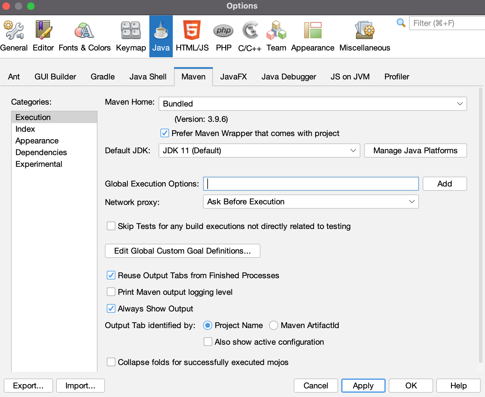

# Don POS
Software de punto de venta basado en uniCenta y OpenBravo.


## Software
* Java 11
* MariaDB 12.3
* Maven
* [Netbeans 21](./doc/NETBEANS.md)

## Install software and configure (Windows)
* Install JDK 11
* Install chocolatey https://community.chocolatey.org/
* Run powershell as Administrator, and then install maven 
```
choco install maven
```

## Important set path of JDK 11 (Windows)
Set JAVA_HOME and set jdk path. Not set jre path. 

## Docker database
```
docker pull mariadb:12.3
```
```
docker run --name mariadb -e MYSQL_ROOT_PASSWORD=R00t -p 3306:3306 -d mariadb:11.4
```
## Create database and user
```
CREATE database donpos;
```
```
CREATE USER 'donpos'@'%' IDENTIFIED BY 'd';
```
```
GRANT ALL PRIVILEGES ON donpos.* TO 'donpos'@'%' WITH GRANT OPTION;
```
### Update password user
```
ALTER USER 'donpos'@'%' IDENTIFIED BY 'd';
```
### Revoke provileges
```
REVOKE ALL ON donpos.* FROM 'donpos'@'%';
```
## Load libraries on local maven repository
Load libraries when unicenta-repo not fount or is offline
### GNU/Linux or MacOS
```
mvn install:install-file -Dfile=./lib/AbsoluteLayout-RELEASE82.jar -DgroupId=org.netbeans.external -DartifactId=AbsoluteLayout -Dversion=RELEASE82 -Dpackaging=jar
```
```
mvn install:install-file -Dfile=./lib/jpos-1.13.jar -DgroupId=com.javapos -DartifactId=jpos -Dversion=1.13 -Dpackaging=jar
```
```
mvn install:install-file -Dfile=./lib/trident-1.4.jar -DgroupId=org.pushingpixels -DartifactId=trident -Dversion=1.4 -Dpackaging=jar
```
```
mvn install:install-file -Dfile=./lib/substance-7.1.00.jar -DgroupId=org.pushingpixels -DartifactId=substance -Dversion=7.1.00 -Dpackaging=jar
```
### Windows
In CMD terminal, not in PowerShell
```
mvn install:install-file -Dfile=.\lib\AbsoluteLayout-RELEASE82.jar -DgroupId=org.netbeans.external -DartifactId=AbsoluteLayout -Dversion=RELEASE82 -Dpackaging=jar
```
```
mvn install:install-file -Dfile=.\lib\jpos-1.13.jar -DgroupId=com.javapos -DartifactId=jpos -Dversion=1.13 -Dpackaging=jar
```
```
mvn install:install-file -Dfile=.\lib\trident-1.4.jar -DgroupId=org.pushingpixels -DartifactId=trident -Dversion=1.4 -Dpackaging=jar
```
```
mvn install:install-file -Dfile=.\lib\substance-7.1.00.jar -DgroupId=org.pushingpixels -DartifactId=substance -Dversion=7.1.00 -Dpackaging=jar
```
## Compile (Windows)
* Get into donpos directory.
* First delete target directory if exist.
* Compile
```
mvn clean package
```
## Compile (GNU/Linux)
* Get into donpos directory.
* First delete target directory if exist.
* Compile
```
mvn clean package
```
## Run (Windows)
```
java -jar .\target\donpos.jar
```
## Run (GNU/Linux)
```
java -jar target/donpos.jar
```
## Run with Netbeans
In menu Tools -> Options



## Format date and hour
```
yyyy-MM-dd H:mm:ss
```
## Add in start.bat (Windows)
```
@echo off
echo Setting JAVA_HOME
set JAVA_HOME=C:\Java\openjdk-11.0.4
echo JAVA_HOME: %JAVA_HOME%
echo setting PATH
set PATH=%JAVA_HOME%\bin;%Path%
echo PATH: %PATH%
echo Display java version
java -version
```
## Problems
### GNU/Linux
* Obtain hostname
It seems that InetAddress.getLocalHost() ignores the /etc/resolv.conf, but only looks at the /etc/hosts file. 
Adding the IP and hostname to this file solves the problem and the exception is gone.

* Access from remote host to database
In /etc/mysql/mariadb.conf.d/50-server.cnf, update 127.0.0.1 to 0.0.0.0
bind-address            = 127.0.0.1

## Utils
### Show databases
```
show databases
```
### Show users 
```
SELECT User, Db, Host from mysql.db;
```
### Show users grants 
```
select distinct concat('SHOW GRANTS FOR ', QUOTE(user), '@', QUOTE(host), ';') as query from mysql.user;
```
### Show users with detail grants 
```
SELECT User, Db, Host, Select_priv, Insert_priv, Update_priv, Delete_priv from mysql.db;
```
### Show database version 
```
select version()
```
### Backup database 
```
mariadb-dump --no-tablespaces --routines --password=yourpass --user=root donpos > donpos.sql
```
### Backup database one table
```
mariadb-dump --no-tablespaces --password=yourpass --user=root donpos tablename > donpos.sql
```
### Backup database one table data only
```
mariadb-dump --no-tablespaces --no-create-info --password=yourpass --user=root donpos tablename > donpos.sql
```
### Restore database
```
mariadb -u root -p donpos < donpos.sql
```
